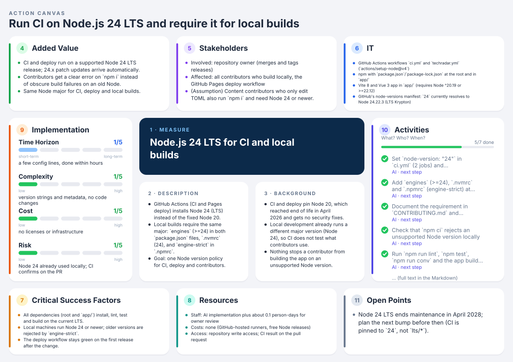

# Run CI on Node.js 24 LTS and require it for local builds

<!-- canvas-meta: branch=feature/ci-node-lts; lang=en; phase=ongoing; created=2026-11-20; updated=2026-11-20 -->

## Measure
- Node.js 24 LTS for CI and local builds

## Description
- GitHub Actions (CI and Pages deploy) installs Node 24 (LTS) instead of the fixed Node 20.
- Local builds require the same major: `engines` (>=24) in both `package.json` files, `.nvmrc` (24), and `engine-strict` in `.npmrc`.
- Goal: one Node version policy for CI, deploy and contributors.

## Background
- CI and deploy pin Node 20, which reached end of life in April 2026 and gets no security fixes.
- Local development already runs a different major version (Node 24), so CI does not test what contributors use.
- Nothing stops a contributor from building the app on an unsupported Node version.

## Added Value
- CI and deploy run on a supported Node 24 LTS release; 24.x patch updates arrive automatically.
- Contributors get a clear error on `npm i` instead of obscure build failures on an old Node.
- Same Node major for CI, deploy and local builds.

## Stakeholders
- Involved: repository owner (merges and tags releases)
- Affected: all contributors who build locally, the GitHub Pages deploy workflow
- (Assumption) Content contributors who only edit TOML also run `npm i` and need Node 24 or newer.

## IT
- GitHub Actions workflows `ci.yml` and `techradar.yml` (`actions/setup-node@v4`)
- npm with `package.json`/`package-lock.json` at the root and in `app/`
- Vite 8 and Vue 3 app in `app/` (requires Node ^20.19 or >=22.12)
- GitHub's node-versions manifest: `24` currently resolves to Node 24.22.3 (LTS Krypton)

## Critical Success Factors
- All dependencies (root and `app/`) install, lint, test and build on the current LTS.
- Local machines run Node 24 or newer; older versions are rejected by `engine-strict`.
- The deploy workflow stays green on the first release after the change.

## Resources
- Staff: AI implementation plus about 0.1 person-days for owner review
- Costs: none (GitHub-hosted runners, free Node releases)
- Access: repository write access; CI result on the pull request

## Implementation
- Time Horizon: 1/5 – a few config lines, done within hours
- Complexity: 1/5 – version strings and metadata, no code changes
- Cost: 1/5 – no licenses or infrastructure
- Risk: 1/5 – Node 24 already used locally; CI confirms on the PR

## Required Activities for Implementation
- [x] Set `node-version: "24"` in `ci.yml` (2 jobs) and `techradar.yml` — AI — next step
- [x] Add `engines` (>=24), `.nvmrc` and `.npmrc` (engine-strict) at root and in `app/` — AI — next step
- [x] Document the requirement in `CONTRIBUTING.md` and `app/README.md` — AI — next step
- [x] Check that `npm ci` rejects an unsupported Node version locally — AI — next step
- [x] Run `npm run lint`, `npm test`, `npm run conv` and the app build on Node 24 — AI — next step
- [ ] Review the pull request and check that CI is green on Node 24 — Requester — before merging
- [ ] Check the first Pages deploy after the next release — Requester — before go-live

## Open Points
- Node 24 LTS ends maintenance in April 2028; plan the next bump before then (CI is pinned to `24`, not `lts/*`).
